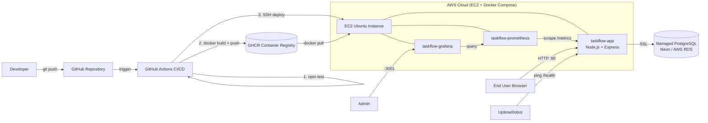

# TaskFlow - Architecture Diagram

## Components
| Component | Technology | Purpose |
|---|---|---|
| Frontend | HTML/CSS/JS | Login + task UI |
| Backend | Node.js, Express | REST API + JWT auth |
| Database | Managed PostgreSQL | Users & tasks storage |
| Container | Docker, Docker Compose | Packaging & orchestration |
| CI/CD | GitHub Actions | Test, build, push, deploy |
| Registry | GitHub Container Registry | Docker image storage |
| Cloud | AWS EC2 | Hosting |
| Monitoring | Prometheus + Grafana + UptimeRobot | Metrics, dashboards, uptime alerts |
